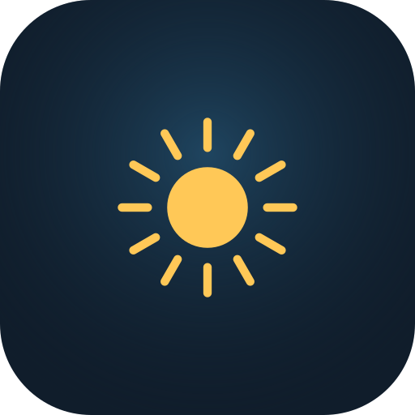

# Aura

**El cielo y el tiempo, a tu manera.**

Aplicación Android de clima, hora y widgets minimalistas con **transparencia real**: se colocan directamente sobre el fondo de pantalla y solo se ven los números, textos e iconos. Optimizada para el Samsung Galaxy S24+ (One UI), compatible con Android 8.0+.

<p align="center"></p>

## Qué incluye

- **5 widgets** (Clock, Weather, Duo, Forecast, Night), cada uno con composición pequeña, mediana y grande.
- **Fondos:** transparente, cristal, oscuro, claro o personalizado, opacidad 0–100 %.
- **Personalización por widget:** colores de texto e iconos, iconos a color o monocromo, tamaño de hora y temperatura, 4 tipografías del sistema, alineación, espaciado, sombra, fecha/ubicación/máx.-mín., 12/24 h. Perfiles Aura Minimal, Glass, Dark, Light y Custom.
- **Vista previa interactiva** sobre fondos de prueba (incluidos los colores de tu fondo real) con aviso de contraste WCAG.
- **App:** Inicio, Pronóstico (por horas y 6 días), Widgets, Personalizar, Ubicación (automática aproximada o ciudades) y Ajustes.
- **Clima:** Open-Meteo, sin clave API ni suscripción; caché sin conexión con marca de datos desactualizados.
- **Ligera:** reloj mediante `TextClock` (sin despertar la app), WorkManager para el clima, sin servicios permanentes ni Google Play Services.

## Estructura

```
core/   Kotlin puro: modelos, proveedor Open-Meteo, frescura de datos, estilos, tamaños (+ pruebas JVM)
app/    Android: Compose (Material 3), DataStore, WorkManager, widgets RemoteViews
tools/  Generadores de iconografía (SVG + VectorDrawable) y layouts de widgets
docs/   Diseño, widgets, permisos y licencias, compilación, pruebas
```

## Documentación

- [Sistema de diseño](docs/DISENO.md)
- [Widgets y transparencia](docs/WIDGETS.md)
- [Permisos, privacidad, dependencias y licencias](docs/PERMISOS_Y_LICENCIAS.md)
- [Compilación e instalación](docs/COMPILACION.md)
- [Pruebas y resultados](docs/PRUEBAS.md)
